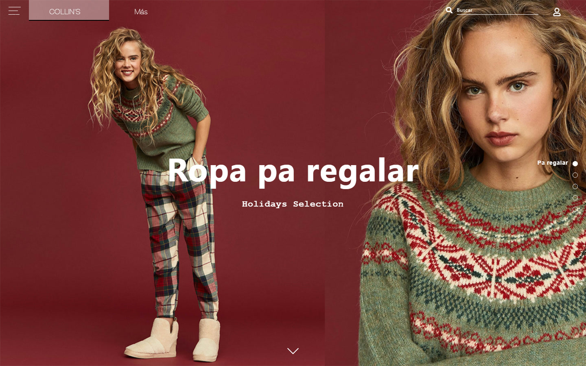
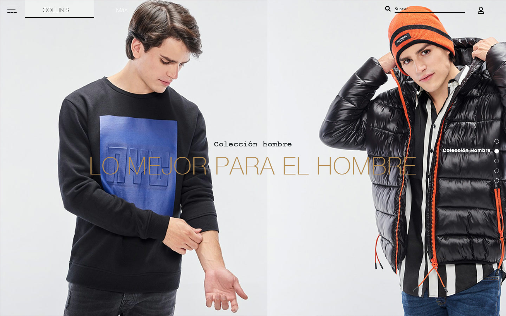
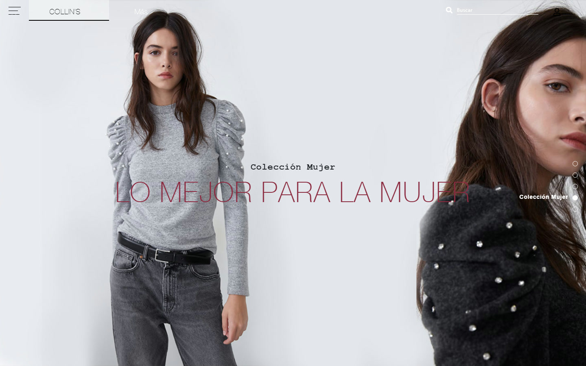
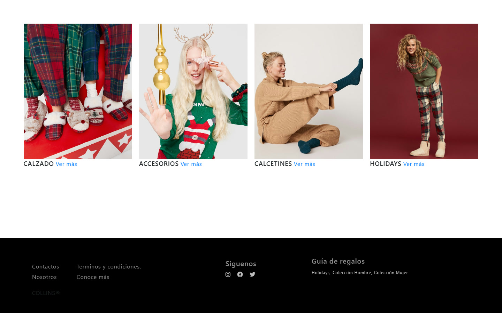
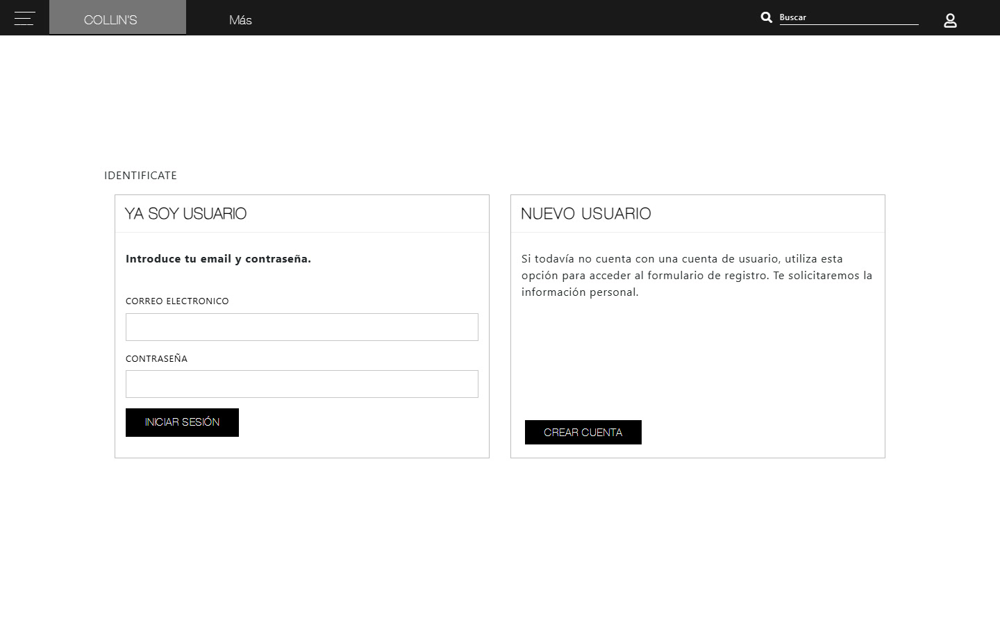
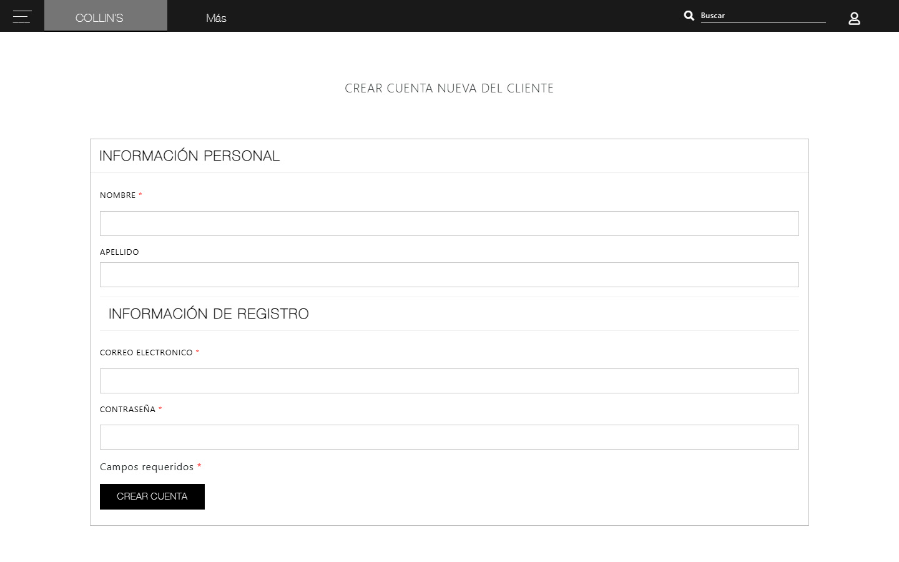

<div align="center">
  
  <h1>COLLIN'S — E-commerce de moda</h1>
  <p><strong>Una experiencia editorial de temporada para descubrir colecciones y acceder a la tienda.</strong></p>
  <p>
    <a href="https://github.com/JosueLuceroG"><strong>Volver al perfil de GitHub ↗</strong></a>
  </p>
</div>

---

> [!NOTE]
> Proyecto front-end de portafolio. Las pantallas de acceso y registro son demostrativas: no incluyen autenticación, carrito, pagos ni backend.

## El proyecto

COLLIN'S es un concepto de tienda de moda desarrollado en 2019 alrededor de una campaña de temporada. El sitio traslada el lenguaje visual de un lookbook editorial a una experiencia web de pantalla completa: fotografía protagonista, navegación entre colecciones y una estructura de acceso sencilla.

La propuesta combina rojo vino, negro, blanco y acentos metálicos con tipografía editorial, menús laterales y transiciones entre secciones. El resultado es una pieza de portafolio enfocada en composición visual, navegación e interfaz.

## Lo que incluye

- **Portada editorial** con imagen de campaña, llamado a la acción y navegación de secciones.
- **Campaña Holidays** con una sección de video a pantalla completa.
- **Colecciones Hombre y Mujer** presentadas como páginas visuales independientes.
- **Galería de categorías** para calzado, accesorios, calcetines y Holidays.
- **Menú lateral** y menú de cuenta para acceder a las pantallas de cliente.
- **Inicio de sesión y registro** con formularios y validación visual, sin persistencia.
- **Navegación full-screen** mediante fullPage.js, con indicadores y anclas por sección.

## Capturas

<table>
  <tr>
    <td width="50%" align="center">
      
      <br />
      <sub>Colección Hombre</sub>
    </td>
    <td width="50%" align="center">
      
      <br />
      <sub>Colección Mujer</sub>
    </td>
  </tr>
</table>

<div align="center">
  
  <br />
  <sub>Galería de categorías y cierre de la experiencia.</sub>
</div>

### Acceso a clientes

<table>
  <tr>
    <td width="50%" align="center">
      
      <br />
      <sub>Iniciar sesión</sub>
    </td>
    <td width="50%" align="center">
      
      <br />
      <sub>Crear cuenta</sub>
    </td>
  </tr>
</table>

<sub>Capturas obtenidas de la versión local a 1440 × 900 px.</sub>

## Stack técnico

| Capa | Tecnología |
| --- | --- |
| Estructura | HTML5 |
| Estilos | CSS3, tipografías locales y fondos a pantalla completa |
| Interacción | JavaScript y jQuery 3.3 |
| Componentes | Bootstrap 4.3 |
| Navegación | fullPage.js 3.0.7 |
| Iconografía | Font Awesome |
| Recursos | Fotografía, video y fuentes incluidas en el repositorio |

## Estructura del proyecto

```text
Collins-Store/
├── index.html
├── login.html
├── signup.html
├── assets/
│   ├── css/
│   ├── font/
│   └── js/
├── media/
└── screenshots/
```

## Cómo ejecutarlo

El proyecto es estático y no requiere compilación:

```bash
python -m http.server 8000
```

Abre `http://localhost:8000` en el navegador. Las dependencias de interfaz se cargan mediante CDN, por lo que se necesita conexión a internet para visualizar todos los estilos e iconos.

## Estado y alcance

- **Tipo:** demostración front-end estática.
- **Origen:** proyecto de diseño y desarrollo web de 2019.
- **Experiencia:** optimizada para escritorio a 1440 px.
- **Funcionalidad:** los formularios, la búsqueda y los enlaces de catálogo son visuales o demostrativos.
- **Backend:** no incluido.
- **Imágenes de categorías:** servidas localmente para que la demo no dependa de URLs externas.


<div align="center">
  <sub>Proyecto de portafolio. Código disponible para revisión. Todos los derechos reservados.</sub>
</div>

## Créditos

Diseño y desarrollo: **Josué Lucero**.

Proyecto de portafolio. Todos los derechos reservados. CheckID, Windows, Excel, Qt y PySide6 son marcas de sus respectivos titulares; este proyecto no está afiliado a ellos.

---

<div align="center">
  <sub>Hecho en México · <a href="https://github.com/JosueLuceroG">github.com/JosueLuceroG</a></sub>
</div>
